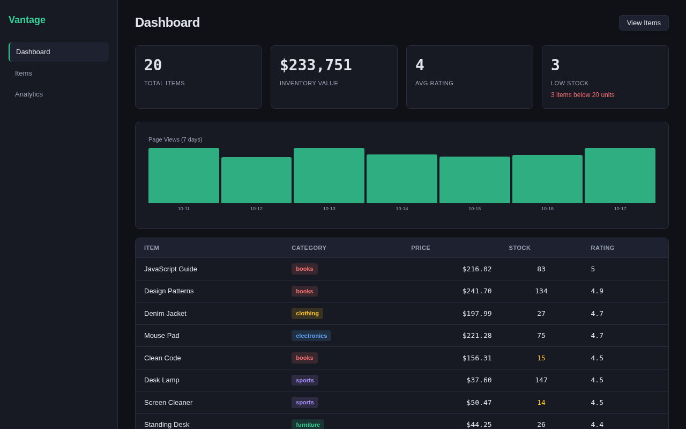
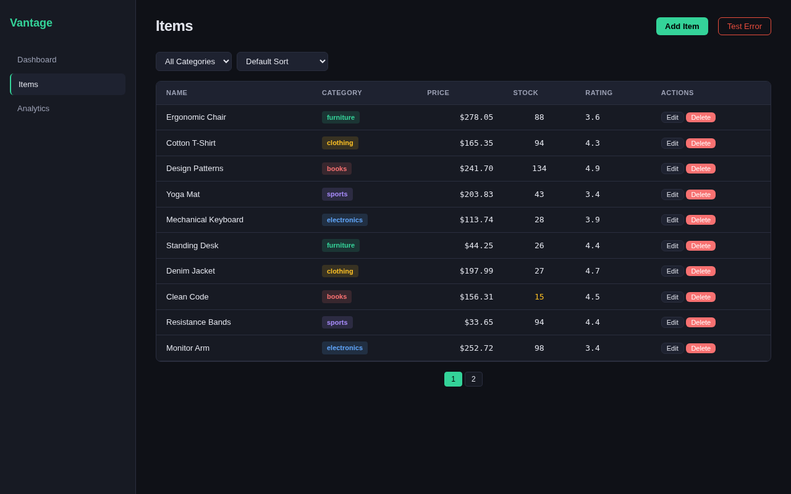
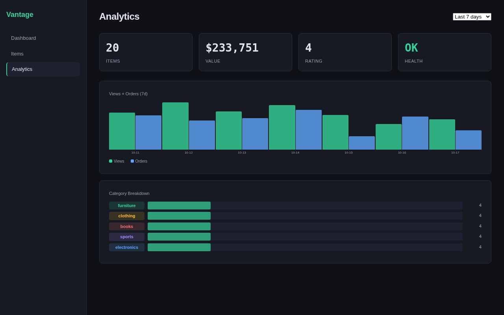
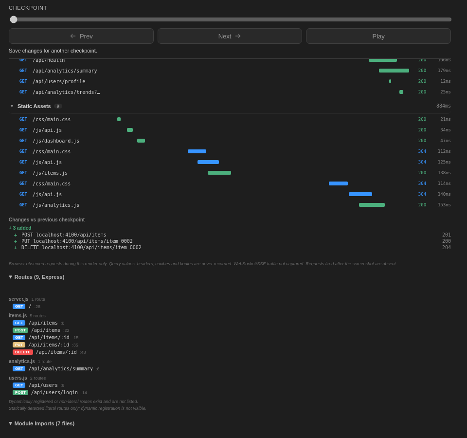
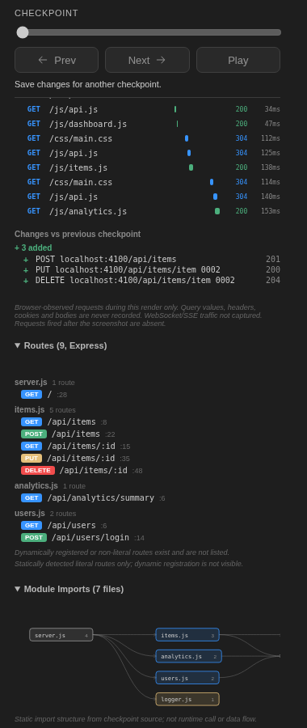
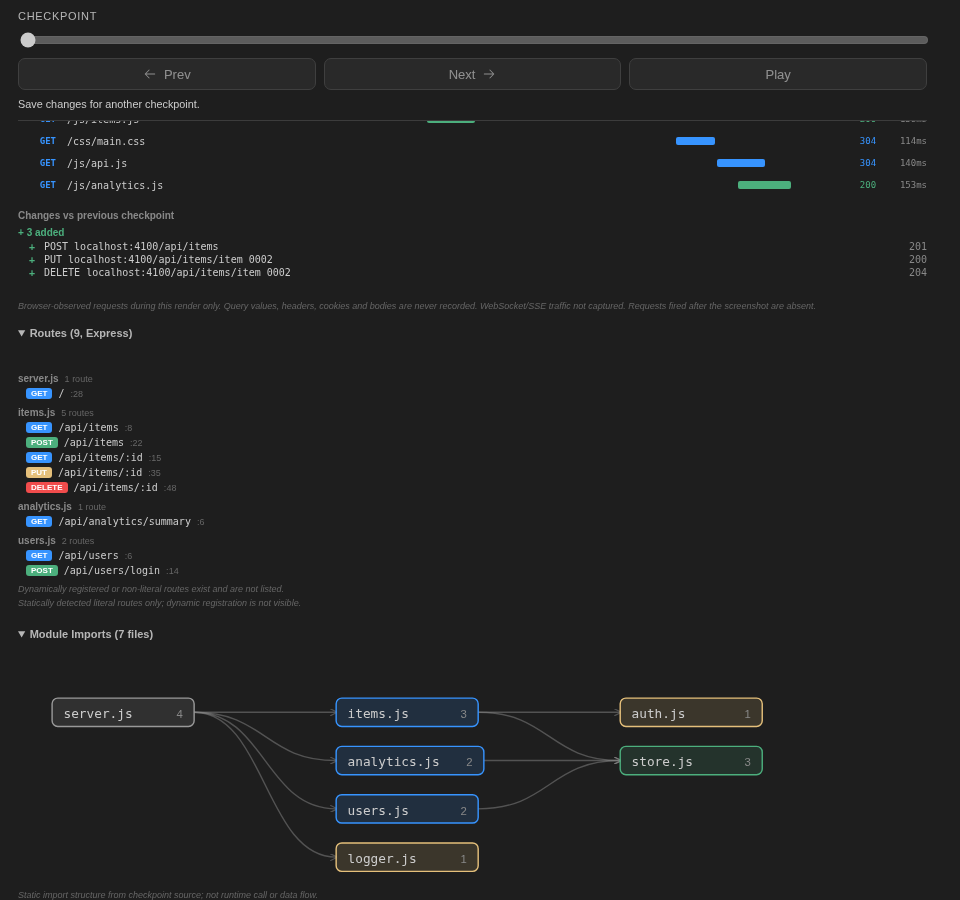

# Vantage Commerce - Scrubline Backend Lab

Mock backend for testing the Scrubline extension's backend visualization panel.

## Screenshots

### Dashboard


### Items (CRUD)


### Analytics


### Scrubline Backend Visualization




## Stack

- Express 4 server on port 4100
- In-memory data store (20 seeded items, resets on restart)
- Middleware chain: request logger, simulated auth check
- Static file serving for the dashboard UI

## API Endpoints

| Method | Path | Description |
|--------|------|-------------|
| GET | `/api/items` | List items (supports `?page`, `?limit`, `?category`, `?sort`) |
| GET | `/api/items/:id` | Get single item |
| POST | `/api/items` | Create item |
| PUT | `/api/items/:id` | Update item |
| DELETE | `/api/items/:id` | Delete item (returns 204) |
| DELETE | `/api/items/:id/confirm` | Delete item (returns 200 with body) |
| GET | `/api/analytics/summary` | Aggregated stats |
| GET | `/api/analytics/trends` | Time-series data (`?period=7d`) |
| GET | `/api/users` | List users |
| GET | `/api/users/profile` | Current user profile |
| POST | `/api/users/login` | Simulated login |
| GET | `/api/health` | Health check (`?deep=true` returns 500) |

## Run

```bash
npm install
node server.js
# Open http://localhost:4100/
```

## Pages

- `/` - Dashboard with metric cards, trend chart, top items
- `/items` - Item CRUD with filters, pagination, modals
- `/analytics` - Analytics view

## Project Structure

```
server.js           - Express app entry
routes/items.js     - Item CRUD routes
routes/analytics.js - Analytics routes
routes/users.js     - User routes
middleware/logger.js - Request logging
middleware/auth.js   - Simulated auth check
db/store.js          - In-memory data store
public/              - Static dashboard UI
```
